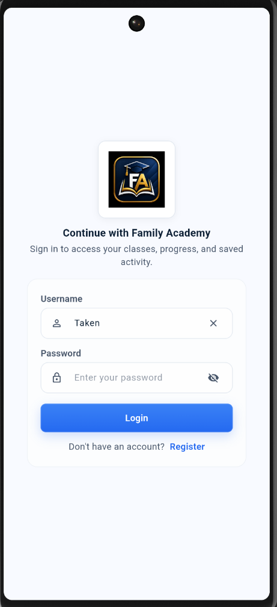
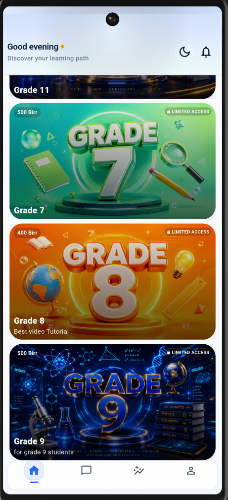
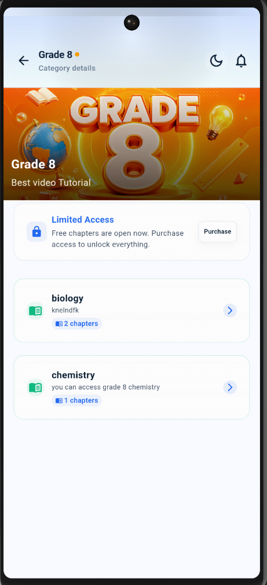
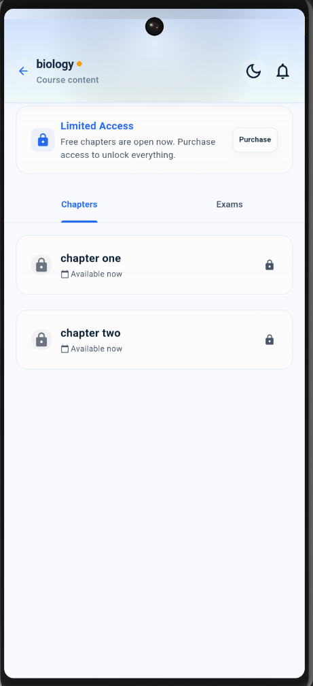
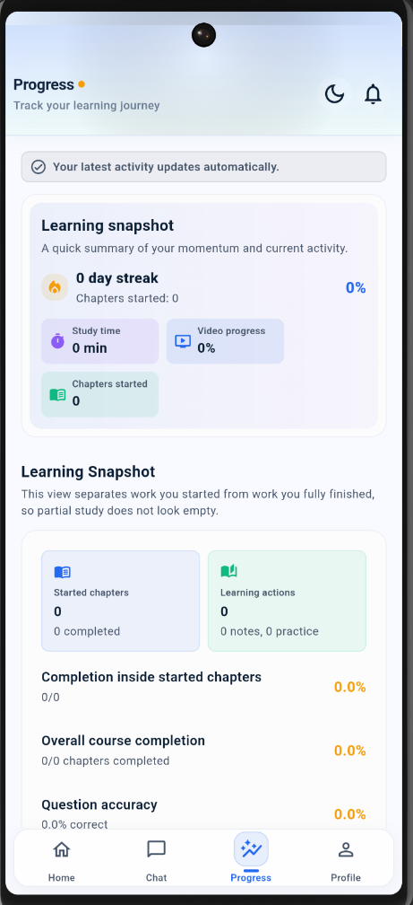
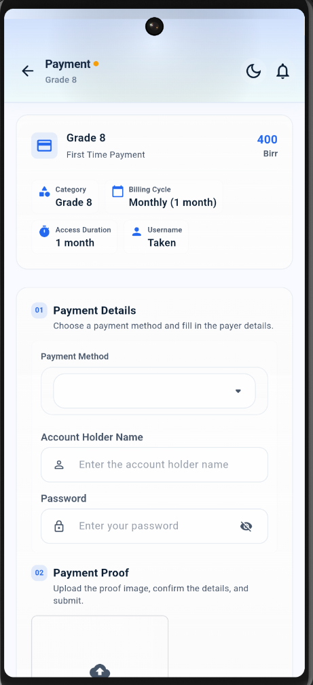
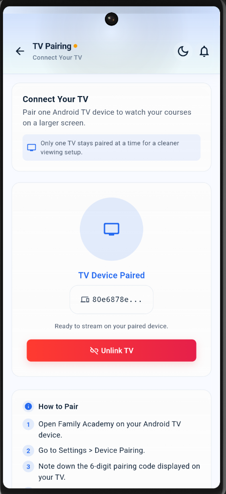
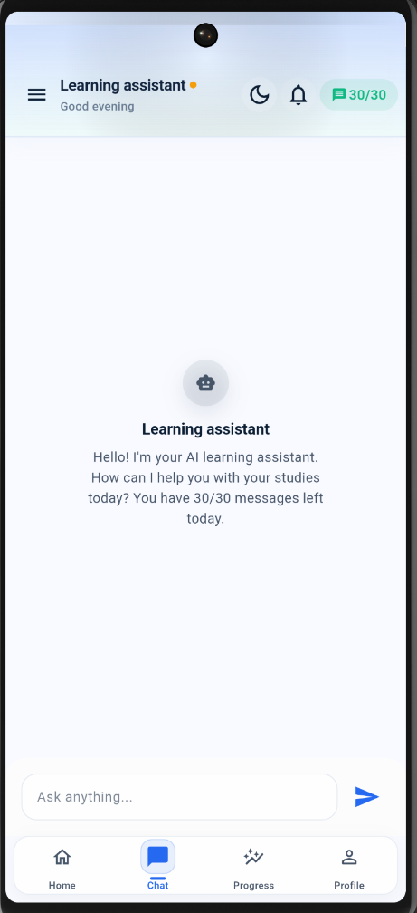

# Family Academy Client

Production Flutter client for the Family Academy learning platform.

This app is one part of the broader Family Academy system:

- Student mobile app
- TV app
- Admin dashboard
- Backend API
- Public landing page

## What it does

- Student authentication and profile management
- Course browsing with notes, videos, practice questions, and exams
- Progress tracking, streaks, and achievement reporting
- Payment proof upload and subscription access control
- TV pairing and parent linking
- Desktop builds for Windows, macOS, and Linux

## Screenshots

Real screenshots from the running student app are stored in [docs/screenshots/](docs/screenshots/README.md).

### Featured screens

| Screen | Preview |
| --- | --- |
| Login |  |
| Home |  |
| Category detail |  |
| Course detail |  |
| Progress |  |
| Payment |  |
| TV pairing |  |
| Chatbot |  |

## Release Downloads

Official downloadable builds are published through GitHub Releases and surfaced from the public landing page.

- Windows installer
- Windows portable zip
- macOS zip
- Linux tarball
- Android split APKs
- Android universal APK
- Android App Bundle

## Local Development

### Requirements

- Flutter SDK 3.0 or newer
- Dart SDK 3.0 or newer

### Setup

```bash
git clone https://github.com/kalaabalb/family-academy-client.git
cd family-academy-client
```

For Flutter app work, install packages and run the target platform normally:

```bash
flutter pub get
flutter run
```

## Environment

Copy `.env.example` to `.env` and provide your API endpoint and release configuration values.

## Build

- `flutter build apk --release`
- `flutter build appbundle --release`
- `flutter build windows --release`
- `flutter build macos --release`
- `flutter build linux --release`

## Notes

- Keep secrets out of source control.
- Release artifacts are generated in GitHub Actions and published to GitHub Releases.
- The repo is intended to stay source-only; generated outputs should remain ignored.

## Related repositories

- Backend API: https://github.com/kalaabalb/family-academy-backend
- TV app: https://github.com/kalaabalb/family-academy-client-tv
- Admin dashboard: https://github.com/kalaabalb/family-academy-admin
- Landing page: https://github.com/kalaabalb/familyacademy.et
